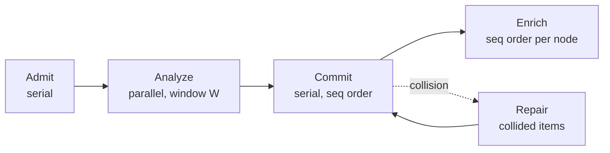

# Concurrent ingestion for one graph

Specification	Concurrent ingestion for one graph (`group_id`)
Category	Graphiti Core
Drafted At	2026-11-14
Status	Implemented as an opt-in mode. The default is off.
Authors
Daniel Chalef

## 1. Overview

Today a caller must add the episodes of one graph one at a time. Extraction,
node dedupe, edge dedupe, and edge invalidation for one episode read the graph
and then write it. Two episodes that run at the same time do not see the
writes of each other. The result is duplicate entities, duplicate facts, facts
that are not invalidated, and lost updates.

This spec adds an opt-in ingestion mode that runs the analysis of many
episodes of one `group_id` at the same time. The mode uses optimistic
concurrency:

1. **Admit.** Graphiti assigns a sequence number and writes the episode node.
   This phase is serial and short.
2. **Analyze.** Graphiti extracts and resolves the episode against the graph
   that it can read. This phase writes nothing to the graph. Up to `window`
   units run this phase at the same time.
3. **Commit.** In sequence order, Graphiti reads the candidates again, repairs
   only the items that have a candidate that the analysis did not see, and
   writes the result. This phase is serial.
4. **Enrich.** Graphiti extracts node attributes and summaries after the
   commit, in sequence order for each node.

The mode is off by default. When the mode is off, no code path of today
changes. The mode adds no required dependency.

Graphiti has no task queue and no state store today. The spec thus puts the
algorithm and the data model in Graphiti, and puts durable state behind one
interface (`IngestionStateStore`). A host application can supply its own
orchestration and its own state store.

## 2. State stores

### 2.1. The two stores of this change

Graphiti core needs no new database for this mode. This change ships two
stores, and it ships no other store:

| Store | Dependency | Use |
|---|---|---|
| `InMemoryIngestionStateStore` | None | Default. One process for each graph. |
| `SQLiteIngestionStateStore` | None (`sqlite3`, standard library) | One host. Durable. More than one process. |

- The algorithm needs a small amount of state for each graph (section 8.1).
  The default store keeps that state in memory. One process that ingests one
  graph needs no other store.
- A durable store that more than one process can use is necessary in two
  cases. In the first case, more than one process ingests into one
  `group_id`. In the second case, a crash must not lose a commit that is in
  progress. `SQLiteIngestionStateStore` is the store for these two cases.
- Each method of the interface is one short transaction on three small
  tables.
- A host application can implement `IngestionStateStore` on a store of its
  own (section 9). The interface and the conformance tests of section 14.2
  are the contract.

### 2.2. Evidence

| Subject | Evidence | Status |
|---|---|---|
| Ingestion write is atomic only on Neo4j | The write uses `session.execute_write` (`bulk_utils.py` 136-148). On Neo4j that call is a managed transaction of the `neo4j` package. The FalkorDB and Neptune sessions await the function directly (`falkordb_driver.py` 107-109, `neptune_driver.py` 381-383). | Verified |
| Only Neo4j has a real `transaction()` | `neo4j_driver.py` 148-158 overrides it. The base class returns a wrapper that runs each query immediately (`driver.py` 146-166, 213-220). No ingestion code calls `transaction()`. | Verified |
| `sqlite3` is already in use | `llm_client/cache.py` 21 and 37. | Verified |

### 2.3. What the state must hold

| Subject | Design |
|---|---|
| The parts of the state | A sequence number, the change sets, and the commit order are not sufficient. The commit log and the change sets are one record in two states. Two more parts are necessary: a lease for admission, and the enrichment order for each node (section 8.1). |
| One process | Memory can hold the state. |
| A durable store | It is necessary only for more than one process or for crash safety. |
| The graph database as the store | The graph database does not hold the state. Each store method needs one atomic statement, and a multi-statement transaction is not necessary. The reasons are: `GraphDriver` has no compare-and-set operation, each query dialect needs its own implementation, the isolation rules of FalkorDB and Neptune are not verified, and the payloads contain embeddings. |
| The commit owner | No lease for each graph is necessary. The unit at the head of the sequence is the only unit that can commit. A fence number on that unit rejects a stale attempt (section 8.3). |
| The end date of a contradicted fact | The date rules of serial ingestion apply. They are in `_apply_temporal_invalidation` and `resolve_edge_contradictions` (`edge_operations.py`). A fact that starts later ends a fact that starts earlier: the `invalid_at` of the earlier fact becomes the `valid_at` of the later fact. Step C7 applies the rules in the two directions. |

## 3. Terms

- **Unit:** one call of `add_episode` or one call of `add_episode_bulk`. A unit
  has one sequence number. A bulk unit has many episodes.
- **Sequence number (`seq`):** an integer for each `group_id`. The first value
  is 1. The state store assigns it at admission.
- **Watermark:** the largest `seq` for which that unit and each earlier unit is
  committed or failed.
- **Snapshot (`snapshot_seq`):** the watermark that a unit reads before its
  first graph read in the Analyze phase.
- **Stored record:** a node or an edge that is in the graph before the unit
  commits. A unit did not create its UUID.
- **Change set:** the output of the Analyze phase. It contains records to
  create and operations on stored records. It contains no copy of a stored
  record.
- **Delta:** the final change sets of the units that committed after
  `snapshot_seq` and before the unit.
- **Collision:** an item that the unit creates has a candidate at commit time
  that the analysis did not see.
- **Repair:** the dedupe or contradiction decision for a collided item against
  the candidates that the analysis did not see.
- **Window:** the largest number of units of one `group_id` that are between
  admission and the end of enrichment in one process.

## 4. Scope

### 4.1. In scope

- A new package `graphiti_core/ingestion/` with the change set, the state
  store interface, two stores, the phase functions, and an in-process
  scheduler.
- A constructor parameter `concurrent_ingestion` on `Graphiti`.
- `add_episode` and `add_episode_bulk` on the new path when the parameter is
  set.
- Five refactors with no behavior change, and two update queries (section
  13.2).
- Telemetry through `graphiti_core/tracer.py`.
- Unit tests, store conformance tests, and a replay test.
- A README section, and an update to the `add_episode` docstring.

### 4.2. Out of scope

- A state store other than the two stores of section 2.1.
- A change to `server/` or `mcp_server/`. The MCP server keeps its queue with
  one worker for each `group_id` (`mcp_server/src/services/queue_service.py`
  12-80).
- `add_triplet`, `remove_episode`, `build_communities`, and the node and edge
  namespace methods. They do not use the sequence (section 12.2).
- `update_communities=True`. On the new path, `add_episode` raises
  `ValueError` for this value.
- A change to a prompt, a response model, a search configuration, or an
  existing save query.

### 4.3. Blast radius

- A user who does not set `concurrent_ingestion` gets no change. The existing
  bodies of `add_episode` and `add_episode_bulk` stay as they are.
- No new required dependency and no new optional extra.
- The refactors move code and add optional parameters. Existing callers get
  the same behavior. The two update queries are new and only the new path
  uses them.

## 5. What the code does today

- `add_episode` reads the previous episodes, extracts and resolves nodes,
  extracts and resolves edges, extracts attributes and summaries, and then
  writes all records in one call (`graphiti.py` 1435-1531). Its docstring
  tells the caller to add each episode sequentially (1410-1413).
- `add_episode_bulk` writes the episode nodes first (1697-1704), dedupes the
  batch in memory, resolves each episode against the graph, and writes one
  time (1776-1783).
- Extraction reads no graph state. Its inputs are the episode and the previous
  episodes (`node_operations.py` 73-162). `extract_edges` and the combined
  extraction do not use the driver.
- Node resolution reads the graph for candidates: an identity lookup, an
  exact-name lookup, and a cosine search (`node_operations.py` 456-484).
- Edge resolution reads the graph two times for each edge: a search with an
  endpoint filter for duplicates (`edge_operations.py` 526-539), and a search
  with an empty `SearchFilters()` for invalidation candidates (558-571).
- Resolution changes stored records in memory. A duplicate fact resolves to
  the stored edge object, and the code adds the episode to it (947-955,
  1009-1015, 905-908). An invalidation sets `invalid_at` and `expired_at` on
  the stored candidate (779-781) or on the resolved edge (727-728, 741-742). A
  duplicate node gets new labels and attributes (`dedup_helpers.py` 171-204).
- Each save query replaces the full record. Nodes: `MERGE` on `uuid`, then
  `SET n = node` (`node_db_queries.py` 194-269). Edges: `MERGE` on `uuid`,
  then `SET e = edge` (`edge_db_queries.py` 65-186). The
  driver operation classes use the same query builders.
- The invalidation rules compare dates only (`edge_operations.py` 715-783).
  When a writer has the correct candidates, the result does not depend on the
  write order.
- Attribute and summary extraction reads the summary and the attributes of the
  node object and writes new values (`node_operations.py` 1031-1085,
  1088-1169). The operation is a read-modify-write of one node.

These facts give three rules for the design:

1. The problem is candidate visibility. The order of arrival is not the cause.
2. A change set must not contain a copy of a stored record, because the save
   query replaces the full record.
3. A node summary needs one writer at a time for each node.

## 6. Design



### 6.1. Admit

The Admit phase gives the unit its position and makes its episodes visible as
context to later units.

1. The caller gets the admit lease and the sequence number in one store call:
   `begin_admit(group_id, unit_id, ttl)`. The store assigns `seq`. The order
   of admission is thus a property of the store. The order in which tasks
   start has no effect.
2. With the lease, the caller reads the previous episodes of the unit, with
   the same calls as today (`graphiti.py` 1435-1445 for one episode, 1707-1709
   for a bulk unit).
3. With the lease, the caller writes the episode nodes with an empty
   `entity_edges` list. When `store_raw_episode_content` is `False`, the
   written node has empty content, as today. The unit keeps the content in
   memory. The write is create-only: the caller first reads the nodes by
   their UUIDs, and it writes only the nodes that are not in the graph. The
   admission does not change a stored episode node.
4. The caller releases the lease: `end_admit(group_id, seq)`.

Steps 2 and 3 run in `seq` order, because one unit has the lease at a time and
the store assigns `seq` with the lease. The previous episodes of a unit are
thus the same as in serial ingestion.

When the caller gives `uuid` for an existing episode, step 3 loads that
episode and does not write it (`graphiti.py` 1448-1450).

One attempt at a time has a `unit_id`. A host that retries a task must use
the same `unit_id`.

- A second admission with the `unit_id` of a live unit raises
  `UnitInProgressError(group_id, unit_id, seq)`. `begin_admit` returns the
  `seq` of the live unit with `existing=True` and gives no lease. The Admit
  phase then writes nothing to the graph, and it calls no store method that
  changes state. The first attempt keeps its lease and its unit.
- After `UnitInProgressError`, the host tries the admission again after the
  lease time (`lease_seconds`). If the first attempt is not live at that
  time, `begin_admit` gives a new sequence number, as the third item below
  describes. If the unit is committed, the host does not try again.
- The UUID of an episode node that the unit writes is a function of
  `group_id`, `unit_id`, and the position of the episode in the unit. Each
  admission reads the node with that UUID from the graph. The read does not
  use the state store, because the store deletes the record of a completed
  unit after the retention time. If the node is in the graph, the admission
  does not save it again, and it keeps the content of the episode in memory.
  The stored node keeps its `entity_edges`.
- A unit is not live when its status is `failed` or `apply_failed`, or when
  its deadline is in the past and it has no stored final change set.
  `begin_admit` marks such an expired unit `failed`. The `unit_id` then gets
  a new sequence number. The new unit uses the episode node of the earlier
  unit, so a retry adds no episode node.

### 6.2. Analyze

The Analyze phase is the slow phase. It writes nothing to the graph.

1. The unit calls `start_analysis(group_id, seq)` **before its first graph
   read**. The store returns `snapshot_seq` and the start time.
2. The unit runs extraction, node resolution, and edge resolution with the
   functions of today (`graphiti.py` 1471-1505 for one episode, 1712-1762 for
   a bulk unit). It does not run `extract_attributes_from_nodes`.
3. The unit gives a `ResolutionTrace` to the two resolution functions (section
   13.2). The trace records the candidates that each item saw and each change
   that the functions made to a stored record.
4. The unit computes `name_embedding` for each node that it creates. Each edge
   that it creates has `fact_embedding` after resolution.
5. The unit builds the change set (section 6.3) and stores it:
   `save_change_set(group_id, seq, payload)`.

A node or an edge is **created by the unit** when the unit minted its UUID:
the UUID of an extracted node, of a node that `extract_edges` materialized, or
of an extracted edge. All other resolved records are stored records.

Attribute extraction that node dedupe uses as an input stays in this phase.
`Graphiti.add_episode` has no such step. A host that passes
`identity_properties` to `resolve_extracted_nodes` runs it here.

### 6.3. Change set

A change set has records to create and operations on stored records.

```text
ChangeSet(
  group_id: str,
  unit_id: str,
  seq: int,
  snapshot_seq: int,
  analysis_started_at: float,
  episodes: list[EpisodicNode],            # as the commit must write them
  create_nodes: list[EntityNode],          # with name_embedding, empty summary
  create_edges: list[EntityEdge],          # with fact_embedding and dates
  episodic_edges: list[EpisodicEdge],
  operations: list[Operation],
  node_uuids: list[str],                   # each node of the unit, created or stored
  node_first_episode: dict[str, str],      # node UUID -> episode UUID for enrichment
  seen_node_candidates: dict[str, list[str]],
  seen_node_labels: dict[str, list[str]],
  seen_duplicate_candidates: dict[str, list[str]],
  seen_invalidation_candidates: dict[str, list[str]],
  uuid_map: dict[str, str],                # filled by the commit
  saga_links: list[SagaLink],              # filled by the commit
)
```

```text
Operation =
  | AddEpisodesToEdge(edge_uuid: str, episode_uuids: list[str])
  | EndEdge(edge_uuid: str, invalid_at: datetime | None, expired_at: datetime,
            only_if_open: bool)
  | SetEdgeAttributes(edge_uuid: str, base_attributes: dict[str, Any],
                      attributes: dict[str, Any])
  | PatchNode(node_uuid: str, labels: list[str], attributes: dict[str, Any])
```

Rules:

- A change set contains no copy of a stored node or a stored edge. A reference
  to a stored record is its UUID.
- The unit mints each UUID and each `expired_at` value in the Analyze phase or
  in the repair. The apply step mints nothing.
- `ChangeSet.to_bytes()` returns the compressed JSON of the model
  (`zlib.compress(model_dump_json().encode())`). `ChangeSet.from_bytes()` is
  the inverse. A round-trip test must show that the embeddings are in the
  payload.
- The state store does not read the payload. A host can wrap a store to
  encrypt the payload.

The source of each operation:

| Operation | Source in the Analyze phase |
|---|---|
| `AddEpisodesToEdge` | A fact resolves to a stored edge (`edge_operations.py` 947-955, 1009-1015). |
| `SetEdgeAttributes` | Resolution sets the attributes of a stored edge (1041-1076). `base_attributes` is the map that the analysis read. `attributes` is the map that the analysis computed. |
| `EndEdge`, `only_if_open=True` | `_apply_temporal_invalidation` ends a stored resolved edge (727-728, 741-742). |
| `EndEdge`, `only_if_open=False` | `resolve_edge_contradictions` ends a stored candidate (779-781). `invalid_at` is `valid_at` of the edge that contradicts it. |
| `PatchNode` | An extracted node resolves to a stored node. `labels` and `attributes` are those of the extracted node. |

Graphiti at this commit does not change the name of a stored edge in
resolution. A later change that does so must add an operation type and a rule
for the current state.

### 6.4. Commit

A unit can commit when each earlier unit is committed or failed. The unit
calls `begin_commit(group_id, seq, ttl)` until the store gives it the turn
(section 8.3). The steps below run with the turn. No other unit of the graph
runs these steps at the same time.

**C1. Retry check.** If the turn has a stored final change set, go to step C8
with that change set. Do no model call.

**C2. Load the delta.** `load_delta(group_id, after_seq=snapshot_seq,
before_seq=seq, since=analysis_started_at - index_lag_seconds)`. The result is
the final change sets of the units that committed after the snapshot. When
`index_lag_seconds` is larger than zero, the result also has the units that
committed in that time before the analysis started. The result also has the
units in that range with the status `apply_failed` (step C2a).

**C2a. Units that are `apply_failed`.** The delta can contain the final change
set of a unit with the status `apply_failed`. A part of that change set is
possibly not in the graph. For such a unit, the commit reads the created nodes
and the created edges by UUID and keeps only the records that exist. A record
that does not exist is not a candidate in steps C3 to C6. A new node or a new
edge is thus never merged into a record that is not in the graph.

The implementation uses one rule for each unit of the delta, with the status
`committed` or `apply_failed`: it reads each delta record that matches a
created item by UUID. The read gives the existence of the record and its
current state. A record that a different writer deleted after the commit is
thus also not a candidate.

**C3. Resolve the collided nodes.** For each node in `create_nodes`:

1. Read the candidates again from the graph with `_collect_candidate_nodes`.
   Use the stored `name_embedding`. Do not call the embedder.
2. Add the nodes that the delta created and that match the node by one of
   these rules: the same normalized name, the same identity key, a fuzzy match
   of `_resolve_with_similarity`, or a cosine similarity of the name
   embeddings of `NODE_DEDUP_COSINE_MIN_SCORE` or more. Keep at most
   `NODE_DEDUP_CANDIDATE_LIMIT` delta nodes, with the largest similarity first.
   A stored node that a `PatchNode` of the delta names is also a delta node.
   The commit reads that node by UUID and applies the patch of the delta to
   the copy before the comparison. The Enrich phase of the earlier unit
   possibly did not write the patch at this time, so the graph read of item 1
   can return the node with no identity value.
3. Remove the nodes that this unit creates. Remove the candidates in
   `seen_node_candidates` for the node, with one exception: a stored node that
   a `PatchNode` of the delta names stays a candidate, because the analysis
   saw it before the patch. The exception applies only when the patch has
   attributes, or when the labels of the node with the patch are different
   from the labels that the analysis saw. The change set keeps those labels
   in `seen_node_labels`, because the Enrich phase of the earlier unit can
   write the promoted label before this commit reads the node. A
   patch that changes nothing gives the analysis no new data. Without this
   limit, a node that many units use is a candidate in almost each commit,
   and each such commit makes a model call in the serial phase.
4. If no candidate stays, the node has no collision.
5. If a candidate stays, resolve the node against those candidates with
   `resolve_nodes_with_candidates` (section 13.2). The function tries the
   identity rule and the similarity rule first. It makes one model call for
   all nodes of the unit that those rules do not resolve.

When a node resolves to a candidate, the commit removes the node from
`create_nodes`, adds `uuid_map[node.uuid] = candidate.uuid`, adds a
`PatchNode` for the candidate, and replaces the UUID in `node_uuids` and
`node_first_episode`.

**C4. Apply the UUID map to all edges.** Run `resolve_edge_pointers` on
`create_edges` and on `episodic_edges` with `uuid_map`. Remove an edge that
the function drops. Remove duplicate episodic edges. This step runs before any
edge comparison, because a node merge changes the endpoint pair of each edge
of that node.

**C4a. Remove duplicates between the created edges.** A node merge in step C3
can give two created edges of the unit the same endpoints. The commit thus
applies the rule of serial ingestion for the edges of one episode again
(`edge_operations.py` 490-518), on `create_edges` in list order. An edge is a
duplicate of an earlier edge when the two have the same source, the same
target, and the same normalized fact. It is also a duplicate when the two have
opposite directions, the same normalized fact, and the same name. The earlier
edge survives and gets the episodes of the duplicate. The commit removes the
duplicate from `create_edges` and replaces its UUID in `entity_edges` of each
episode. This step makes no model call.

**C5. Find edge duplicates.** For each edge in `create_edges`:

1. Search the graph with the endpoint filter, as `edge_operations.py` 526-543
   does. Use the stored `fact_embedding`.
2. Add the edges that the delta created between the same two nodes, in either
   direction.
3. Remove the candidates in `seen_duplicate_candidates` for the edge, and the
   edges that this unit creates.

**C6. Find edge contradictions.** This pass is separate from C5 and has no
endpoint filter. For each edge in `create_edges`:

1. Search the graph with an empty `SearchFilters()`, as `edge_operations.py`
   558-571 does. This is the search of serial ingestion, at the time of the
   commit.
2. Add the edges that the delta created and that have a cosine similarity of
   the fact embeddings of `DEFAULT_MIN_SCORE` or more. Keep at most
   `DEFAULT_SEARCH_LIMIT` delta edges, with the largest similarity first.
3. Remove the duplicate candidates of C5, the candidates in
   `seen_invalidation_candidates` for the edge, and the edges that this unit
   creates.

**C7. Decide the collided edges.** An edge has a collision when C5 or C6 gives
it one candidate or more. For each collided edge, call
`decide_edge_against_candidates` (section 13.2):

1. If a duplicate candidate has the same source, the same target, and the same
   normalized fact, the edge is a duplicate of it. This rule makes no model
   call.
2. If not, make one call of the `dedupe_edges.resolve_edge` prompt. The
   duplicate candidates are the existing facts. The contradiction candidates
   are the invalidation candidates. This is the prompt layout of serial
   ingestion.
3. If the edge is a duplicate of candidate `c`: remove the edge from
   `create_edges`, add `AddEpisodesToEdge(c.uuid, ...)`, and replace the edge
   UUID with `c.uuid` in `entity_edges` of each episode.
4. For each contradicted candidate, apply the date rules of
   `_apply_temporal_invalidation` in the two directions. A candidate that
   starts later ends the edge of the unit. The edge of the unit ends a
   candidate that starts earlier. A change to an edge that the unit creates
   changes that edge in `create_edges`. A change to a candidate becomes an
   `EndEdge` operation, because the candidate is a stored record.
   When the analysis already ended the edge of the unit at the start of a
   contradiction that it saw, a contradicted candidate of the commit that
   starts later than the edge and earlier than that end date moves the end
   date to its start. Serial ingestion gives the same date, because it ends
   an edge at the earliest contradiction that starts later. The change set
   names these edges in `edges_ended_by_candidate`. An end date that the
   episode gave does not move.

The decisions for different edges run at the same time with
`semaphore_gather`. An edge with no collision makes no model call.

**C7a. Sagas.** When the unit has a saga, the commit finds the saga node by
its name, or it uses the `SagaNode` object of the caller. It reads the
previous episode of the saga, as `graphiti.py` 1049-1067 does. It mints the
UUIDs of the `NEXT_EPISODE` and `HAS_EPISODE` edges and stores them in
`saga_links`. This step writes nothing. If no saga has the name, the commit
makes the saga node in memory and sets `create_saga` in the change set. The
change set keeps the saga node in `saga_node`. The apply of step C9 writes
the saga records after the entity records. The apply first reads the saga
node from the graph by its UUID.

- If the saga node is in the graph, the apply writes the edges and then saves
  the node that it read. It changes only `last_episode_uuid`, and
  `first_episode_uuid` when that field is empty. The summary of the saga and
  the dates of the summary thus stay. The fields of a `SagaNode` object of
  the caller do not replace the stored fields.
- If the saga node is not in the graph and `create_saga` is set, the apply
  writes the new saga node, then the edges, then the saga node with its first
  and last episode. A second apply reads the node that the first apply wrote.
- If the saga node is not in the graph and the caller gave a `SagaNode`
  object, the apply writes the edges and then saves that object, as serial
  ingestion does.

A unit that the hook of step C7b rejects thus leaves no saga node.

The save of the saga node replaces each property with the value that the
apply read. A writer outside the sequence that changes the saga node between
the read and the save of one apply loses its change.

**C7b. Host hook.** If `before_commit_write` is set, the commit calls it with
the change set. The hook returns the change set to write. The hook can raise
`ChangeSetRejected`. The unit then fails and releases its position.

**C7c. Make the final change set durable.** `save_final(group_id, seq, fence,
payload)`. This call is before the first graph write of the commit. After this call the unit
becomes `committed` or `apply_failed` (section 6.7). The stored final change
set stays a part of the delta of later units in the two cases.

**C8. Apply the operations to the current state.**

1. Read the current record for each edge UUID in the operations, in one
   `EntityEdge.get_by_uuids` call.
2. If a record does not exist, drop its operations and count them. A writer
   outside the sequence deleted the record. The commit does not create it
   again.
3. Apply each operation to the current record:

| Operation | Rule for the current record |
|---|---|
| `AddEpisodesToEdge` | Add each episode UUID that is not in `episodes`. Keep the order. |
| `EndEdge` | If `only_if_open` and `expired_at` has a value, do nothing. If the operation has `invalid_at`, and the record has no `invalid_at` or a later one, set `invalid_at`. If the record has no `expired_at`, set `expired_at`. |
| `SetEdgeAttributes` | Merge by key with three maps (see below). |
| `PatchNode` | Not applied in the commit. The Enrich phase applies it (section 6.5). |

4. Make sure that each changed record has `fact_embedding`. Load it with
   `load_fact_embedding` when the read did not return it.

Rule for `SetEdgeAttributes`. The maps are `base` (`base_attributes`), `new`
(`attributes`), and `current` (the attributes of the current record). For each
key that is in one of the three maps:

1. If the key has the same state in `current` and in `base` (the same value,
   or absent in the two maps), use the state of `new`. The state can be a
   value or absent.
2. If the state in `current` is different from `base`, keep the state of
   `current`. A different writer changed this key after the analysis read it.

The rule is the merge by key, and for a key that the two sides changed, the
value of the current record stays. The reasons:

- Serial ingestion computes these attributes from the fact of the stored edge,
  the reference time, and the attributes that the edge has at that time
  (`edge_operations.py` 1045-1049). The content of the new episode is not an
  input. Two units thus compute the map for one stored edge from the same
  fact. The value of the earlier commit is as valid as the value of the later
  unit.
- The later unit computed its value with no knowledge of the change. The rule
  never removes a change that the unit did not read.
- The rule makes no model call in the serial phase. A new decision needs one.
- The rule gives the same record when it runs two times. After the first run,
  each key that the unit set has a state that is different from `base`, and
  the second run keeps it.

Serial ingestion uses a full replace of the map (`attribute_utils.py`
252-258). The merge by key is identical to that replace when no writer changed
the edge after the snapshot.

The `EndEdge` rule keeps the earlier end date. This is the result of serial
ingestion: `resolve_edge_contradictions` does not move an end date that is at
or before the start of the new fact (`edge_operations.py` 763-772).

Each rule gives the same record when it runs two times. A retry of step C8
after a partial write is thus safe.

**C9. Write.** Two writes, then the saga writes of `saga_links`:

1. One call of `add_nodes_and_edges_bulk` with the episodes, the episodic
   edges, `create_nodes`, and `create_edges`. Before the call, the commit
   reads the stored episode nodes by UUID. The `entity_edges` of each written
   episode is the stored list and then the UUIDs of the change set that are
   not in the stored list. A commit thus removes no link from an episode
   node. Serial ingestion replaces the list.
2. One update of the changed stored edges with a new query that uses `MATCH`
   on the edge `uuid` and has no `MERGE` (section 13.2, item 6). If a writer
   deleted the edge after the read of step C8, the query matches nothing and
   writes nothing. The commit does not create the edge again.

The commit writes no stored node.

Time limit of a write. A graph write of an attempt must not change the graph
after a different attempt has the turn. The fence protects the state store
only. It does not stop a graph write that is in progress. Three rules give the
protection:

1. The unit keeps the time of its last successful `heartbeat` or
   `begin_commit` call, from a monotonic clock, read before the call. Its
   local deadline is that time plus `lease_seconds`. The local deadline is
   thus never later than the deadline in the store.
2. Before each graph write of step C9, and of step 7 of section 6.5, the
   unit computes the time to its local deadline minus
   `write_margin_seconds`. If the result is zero or less, the unit does not
   write and raises `UnitExpiredError`.
3. The write runs with that result as its time limit. On Neo4j, the limit is
   the transaction timeout of the write, which the server applies. On a
   driver with no such limit, the unit cancels the call at the limit. The
   database can then complete a write that it already started (section 12.3).

4. Immediately before each graph write of step C9, the unit calls
   `heartbeat` with the fence of its turn. If a different attempt has the
   turn, the store raises `StaleCommitError`, and the unit does not write.
   This check also stops an attempt whose local clock did not move while the
   deadline in the store passed, for example on a machine that was suspended.
   If the store gives no answer, rules 1 to 3 apply. The recovery of an
   earlier unit uses the same check with the fence of the recovery.

A different attempt gets the turn only when the deadline in the store is in
the past (section 8.3). This is true for a later unit that recovers the unit,
and for a second attempt of the same unit. Only the attempt with the turn can
move the deadline of a unit in the status `applying`, because `heartbeat`
needs the fence of the turn. With rules 1 to 3, the write of the earlier
attempt is complete or stopped at that time, on a driver that applies the
limit.

**C10. Record.** `finish_commit(group_id, seq, fence, node_uuids,
retain_seconds)`, with `retain_seconds` equal to `index_lag_seconds`. The
watermark moves. The store registers the nodes of the
unit for enrichment in the same transaction.

### 6.5. Enrich

After the commit, the unit extracts attributes and summaries for its nodes.
The window slot of the unit stays in use until this phase ends.

Rule: for one node, the enrichment of two units does not run at the same time,
and it runs in `seq` order. After a node is in the graph, only this phase
writes it.

1. The unit calls `ready_enrich(group_id, seq)`. The store returns the nodes
   of the unit for which no earlier unit has enrichment that is not complete.
2. If the list is empty, the unit waits and calls again.
3. The unit reads the current nodes with `EntityNode.get_by_uuids`.
4. The unit applies each `PatchNode` of those nodes with
   `_promote_resolved_node`.
5. The unit calls `extract_attributes_from_nodes` for those nodes in one call,
   with the episode, the previous episodes, and the edges that the unit
   created. A bulk unit uses the first episode of each node and passes no
   edges, as `graphiti.py` 1197-1209 does.
6. If `before_enrichment_write` is set, the unit calls it with the nodes. The
   hook returns the nodes to write.
7. The unit writes the nodes with a new query that uses `MATCH` on the node
   `uuid` and has no `MERGE` (section 13.2, item 6). A node that a writer
   deleted after step 3 is not created again. The write has the time limit
   of step C9. Then the unit calls
   `finish_enrich(group_id, seq, node_uuids)`.
8. The unit goes to step 1 until each of its nodes is complete.

`PatchNode` does not have the defect of a stale copy. The patch has only the
labels and the attributes of the extracted node. It has no value from the
snapshot. Step 4 merges it into the current node by key: a value of the
extracted node that is not empty replaces the value of that key, and each
other key stays (`dedup_helpers.py` 192-204). Step 5 reads the attributes and
the summary of the current node. For one node, these steps run in `seq` order,
so each unit reads the result of the unit before it.

Nodes with no earlier enrichment in progress are in one batch, so the summary
prompt has the same batches as today. A node that many units use (for example
the node of the user) waits for its turn alone. It does not stop the other
nodes of the unit.

If step 5 raises an exception, the unit logs an error with the node UUIDs,
keeps the summary and the attributes that the nodes have, and continues with
step 6. The graph write of the commit is complete at this point. The call
returns its result and does not raise.

### 6.6. Bulk units

One call of `add_episode_bulk` is one unit with one `seq`.

- Admit writes all episode nodes of the call and reads the previous episodes
  of each one (`graphiti.py` 1680-1709).
- Analyze runs the batch pipeline of today (1712-1762) with no attribute
  extraction. `_resolve_nodes_and_edges_bulk` gets a parameter `hydrate` with
  the default `True`. The new path passes `False`.
- The items of one bulk unit are compared with each other in the Analyze
  phase, as today. The commit compares the unit with the graph and the delta.
- The window counts units. A bulk unit uses one slot.

### 6.7. Failure rules

| Event | Result |
|---|---|
| Exception or cancellation before `save_final` | The unit calls `fail(group_id, seq, reason)`. Its position is released. The episode nodes stay in the graph with no entities. The exception goes to the caller. The caller can call `add_episode` again with `uuid`. |
| Graph write fails after `save_final` | The unit applies the same final change set again, up to `max_apply_attempts` times. No model call is made. |
| All apply attempts fail | The unit calls `fail` with the reason `apply_failed` and logs an error. The status is `apply_failed`, and the position is released. On a backend with no transaction, a part of the write can be in the graph. The store keeps the final change set, and `load_delta` returns it to later units (step C2a). No attempt writes this change set again. |
| The process stops in a phase before `save_final` | The deadline of the unit expires. A later unit marks it failed in `begin_commit`. |
| The process stops after `save_final` | The deadline expires. The next unit gets the stored final change set from `begin_commit`, applies it, and records the commit. Then it continues with its own commit. The nodes of the stopped unit get no enrichment from that unit: the recovery calls `finish_commit` with an empty node list, so that no enrichment entry stays with no owner. If each apply attempt of the next unit fails, that unit calls `fail` for the stopped unit with the reason `apply_failed` and the fence of the recovery, and then continues with its own commit. |
| A unit with an expired deadline calls the store | The store raises `UnitExpiredError` or `StaleCommitError`. The unit stops. |

A unit renews its deadline with `heartbeat` each `lease_seconds / 3` from
admission to the end of enrichment. The Admit phase renews the deadline
itself between `begin_admit` and `end_admit`, because the caller does not have
the `seq` before the phase returns. An admission that takes more time than
`lease_seconds`, for example a large bulk unit, thus keeps its lease.

One slow unit delays the commits behind it. The analysis of those units
continues.

## 7. Comparison with serial ingestion

For each item that a unit creates, the candidates are those of the Analyze
phase plus those of the commit. The commit reads the graph when each earlier
unit is written. The candidate set is thus not smaller than the candidate set
of serial ingestion at the same position.

The result is not always identical to serial ingestion:

1. A model call can give a different answer for the same input.
2. The repair prompt has only the candidates that the analysis did not see.
   Serial ingestion gives all candidates in one prompt.
3. An extracted node that resolves to a stored node in the Analyze phase is
   not compared again. Serial ingestion could select a node that an earlier
   unit of the window created.
4. An edge that resolves to a stored edge in the Analyze phase is not compared
   again. Its operations apply to the current state of that edge.
5. Node dedupe gives the model the first 120 characters of the summary of each
   candidate (`node_operations.py` 703-709). A node that an earlier unit of
   the window created can have an empty summary at that time.

## 8. State store

### 8.1. State

| State | Use |
|---|---|
| Sequence counter and watermark, for each graph | Order of admission and of commit. |
| Admit lease, for each graph | One admission at a time. |
| Unit record: status, snapshot, fence, deadline, times, payload | The change set, the commit log, and the commit owner. |
| Enrichment entries: `(group_id, node_uuid, seq)` | The enrichment order for each node. |

Unit status values: `admitting`, `admitted`, `analyzed`, `applying`,
`committed`, `failed`, `apply_failed`.

### 8.2. Interface

`graphiti_core/ingestion/state_store.py`:

```text
class IngestionStateStore(ABC):
    async def begin_admit(group_id, unit_id, ttl) -> Admission | None
    async def end_admit(group_id, seq) -> None
    async def start_analysis(group_id, seq) -> AnalysisStart
    async def save_change_set(group_id, seq, payload: bytes) -> None
    async def heartbeat(group_id, seq, ttl, fence: int | None = None) -> None
    async def begin_commit(group_id, seq, ttl) -> CommitTurn | CommitWait | CommitRecover
    async def load_delta(group_id, after_seq, before_seq, since: float) -> list[DeltaUnit]
    async def save_final(group_id, seq, fence, payload: bytes) -> None
    async def finish_commit(group_id, seq, fence, node_uuids, retain_seconds) -> None
    async def fail(group_id, seq, reason: str, fence: int | None = None) -> None
    async def ready_enrich(group_id, seq) -> list[str]
    async def finish_enrich(group_id, seq, node_uuids) -> None
    async def close() -> None

Admission(seq: int, existing: bool = False, previous_seq: int | None = None)
AnalysisStart(snapshot_seq: int, started_at: float)
CommitTurn(fence: int, final_payload: bytes | None)
CommitWait()
CommitRecover(seq: int, fence: int, final_payload: bytes)
DeltaUnit(seq: int, status: str, payload: bytes)
```

### 8.3. Contract

Each method is atomic. A store that a host application implements for more
than one host must compare deadlines with the clock of that store.

- `begin_admit`: If `unit_id` has a live unit, return its `seq` with
  `existing=True` and give no lease. If the last unit of `unit_id` is not
  live (section 6.1), mark it `failed` when it is not `failed` or
  `apply_failed`, and continue. The `Admission` of the new unit then has the
  `seq` of that unit in `previous_seq`. If another unit
  has the admit lease and its deadline is in the future, return `None`. If the
  deadline of that unit is in the past, mark that unit `failed` and continue.
  Then assign the next `seq`, create the unit with the status `admitting`, set
  its deadline, give it the lease, and return.
- `end_admit`: Set the status `admitted` and release the lease.
- `start_analysis`: Store and return the watermark and the current time.
- `save_change_set`: Store the payload and set the status `analyzed`. The
  call is permitted only for the status `admitted`. For each other status,
  raise `StaleCommitError` and keep the stored payload. A retry of a unit can
  run the analysis again, and a stored change set must stay. The Analyze phase
  does not call `fail` after this error, so the unit keeps its position.
- `heartbeat`: Set the deadline of a unit to the current time plus `ttl`.
  `fence` is the fence of the commit turn of the caller, or no value for a
  caller with no turn. If `fence` has a value that is not the fence of the
  unit, raise `StaleCommitError`. If the status is `applying` and `fence` has
  no value, raise `StaleCommitError`. Thus only the attempt with the turn
  keeps the deadline of an `applying` unit in the future.
- `begin_commit`: Find the earliest unit before `seq` that is not `committed`
  and not `failed`.
  - If there is none, and the unit has the status `applying` and a deadline
    in the future: return `CommitWait`. A different attempt applies the final
    change set of the unit.
  - If there is none, in each other case: add 1 to the fence of the unit, set
    its deadline, and return `CommitTurn`. `final_payload` has a value only
    when the status is `applying`.
  - If that unit has a deadline in the future: return `CommitWait`.
  - If that unit has a deadline in the past and the status `applying`: add 1
    to its fence, set its deadline, and return `CommitRecover` with its
    payload.
  - If that unit has a deadline in the past and a different status: mark it
    `failed` and look again.
- `load_delta`: Return the payloads of the `committed` units and of the
  `apply_failed` units with a `seq` below `before_seq`, and with a `seq` above
  `after_seq` or an end time at or after `since`. The end time is the commit
  time, or the time of the `fail` call. The result gives the status of each
  unit. The order is `seq` order.
- `save_final`: If `fence` is not the fence of the unit, raise
  `StaleCommitError`. Replace the payload and set the status `applying`.
- `finish_commit`: If `fence` is not the fence of the unit, raise
  `StaleCommitError`. Set the status `committed` and the end time. Add one
  enrichment entry for each node UUID. Move the watermark. Delete old records
  (see below).
- `fail`: Set the status `failed`, delete the enrichment entries of the unit,
  release the admit lease if the unit has it, and move the watermark. The call
  is not permitted for the status `applying`, with one exception: the reason
  `apply_failed`. With that reason, the call needs `fence`. If `fence` is
  not the fence of the unit, raise `StaleCommitError`. The status becomes
  `apply_failed`, the payload stays, and the end time is set.
  For the order of commits, `apply_failed` is equal to `failed`.
- `ready_enrich`: Delete the entries of each unit that has a deadline in the
  past. Return the node UUIDs of the unit for which no entry with a smaller
  `seq` exists.
- `finish_enrich`: Delete the entries of the unit for the node UUIDs.

A method that gets a unit with a deadline in the past, or a unit that is
`failed`, raises `UnitExpiredError`. `begin_commit` and `heartbeat` are the
exceptions for a unit in the status `applying`.

The store deletes a `committed`, `failed`, or `apply_failed` unit when three
conditions are true:

1. Its `seq` is at or below the watermark, and at or below the snapshot of
   each unit that is in progress.
2. Its end time is more than `retain_seconds` in the past.
3. It has no enrichment entry.

### 8.4. `InMemoryIngestionStateStore`

Dictionaries for each `group_id`. No lock is necessary, because each method
has no `await` between its read and its write. The store is correct only when
one process ingests into the graph.

### 8.5. `SQLiteIngestionStateStore`

`SQLiteIngestionStateStore(path: str)`. The store uses `sqlite3` from the
standard library, one connection with `check_same_thread=False` and
`isolation_level=None`, WAL mode, and a busy timeout of 5 seconds. Each method
is one `BEGIN IMMEDIATE` transaction that runs in `asyncio.to_thread` with a
`threading.Lock`. The store creates its tables when it opens the file. I
selected the timeout of 5 seconds. It has no measurement behind it.

```sql
CREATE TABLE IF NOT EXISTS graphiti_ingest_group (
  group_id      TEXT PRIMARY KEY,
  next_seq      INTEGER NOT NULL,
  watermark     INTEGER NOT NULL,
  admit_seq     INTEGER
);
CREATE TABLE IF NOT EXISTS graphiti_ingest_unit (
  group_id      TEXT NOT NULL,
  seq           INTEGER NOT NULL,
  unit_id       TEXT NOT NULL,
  status        TEXT NOT NULL,
  snapshot_seq  INTEGER,
  started_at    REAL,
  ended_at      REAL,
  fence         INTEGER NOT NULL DEFAULT 0,
  deadline      REAL NOT NULL,
  fail_reason   TEXT,
  payload       BLOB,
  PRIMARY KEY (group_id, seq)
);
CREATE INDEX IF NOT EXISTS graphiti_ingest_unit_by_unit_id
  ON graphiti_ingest_unit (group_id, unit_id, seq);
CREATE TABLE IF NOT EXISTS graphiti_ingest_enrich (
  group_id      TEXT NOT NULL,
  node_uuid     TEXT NOT NULL,
  seq           INTEGER NOT NULL,
  PRIMARY KEY (group_id, node_uuid, seq)
);
```

A payload has embeddings. One embedding of 1,024 dimensions is about 22 kB as
JSON and about 10 kB after compression, from a test with random values.

## 9. Ownership: Graphiti and the host application

| Part | Owner |
|---|---|
| The change set, the operations, and the rules for the current state | Graphiti |
| The Analyze, Commit, and Enrich logic, with the repair | Graphiti |
| The `IngestionStateStore` interface and its conformance tests | Graphiti |
| The in-memory store and the SQLite store | Graphiti |
| The in-process scheduler (window, waits, heartbeat) | Graphiti. A host can replace it. |
| A store on the database of the host | Host |
| Queues, workers, retries, and the placement of each phase | Host |
| The decision to use the new path for a graph | Host |
| Changes to a change set or to enriched nodes before a write | Host, through the two hooks |
| Writers outside the sequence (section 12.2) | Host |

### 9.1. Phase functions

A host with its own orchestration does not use the scheduler. It calls the
phase functions of `graphiti_core/ingestion/phases.py` from its own tasks.
Each function takes the `Graphiti` object, the store, and the configuration.
The functions use the same methods of `Graphiti` as serial ingestion (for
example the episode retrieval, the edge extraction, and the saga methods), so
the first parameter is the object and not only its clients. The scheduler uses
the same functions.

```text
admit_episode(graphiti, store, config, *, unit_id, group_id, ...) -> AdmittedUnit
admit_bulk(graphiti, store, config, *, unit_id, group_id, ...) -> AdmittedUnit
analyze_episode(graphiti, store, config, unit, *, entity_types, ...) -> ChangeSet
analyze_bulk(graphiti, store, config, unit, *, entity_types, ...) -> ChangeSet
commit_unit(graphiti, store, config, unit, change_set, *, entity_types, ...)
    -> CommitResult
enrich_unit(graphiti, store, config, unit, commit_result, *, entity_types, ...)
    -> list[EntityNode]
```

- `AdmittedUnit` has `group_id`, `unit_id`, `seq`, the episodes with their
  content, and the previous episodes. It is a Pydantic model, so a host can
  pass it between tasks.
- `commit_unit` and `enrich_unit` take a parameter `wait`. The function awaits
  it when the store answers that the unit must wait. The default sleeps for
  `poll_interval_seconds`.
- `commit_unit` handles `CommitRecover` itself: it applies the stored final
  change set of the earlier unit and records that commit.
- The host calls `heartbeat` for a unit while a task of that unit runs.
- A retry of a host task is safe. For the `unit_id` of a live unit, the
  Admit phase raises `UnitInProgressError` and writes nothing (section 6.1). A second `save_change_set` raises `StaleCommitError` and
  keeps the stored change set.
  `begin_commit` returns the stored final change set when one exists, and the
  fence rejects the older attempt. The retry gets the turn only after the
  deadline of the older attempt, so the host must stop the heartbeat of an
  attempt that ended.
- After `commit_unit` has the turn, the host passes the fence of the turn to
  `heartbeat`. `UnitLease` does this.
- A host that assigns sequence numbers before admission (for example in the
  request that accepts the episode) implements `begin_admit` to return that
  number, and to give the admit lease in number order.

Two functions are public for a host that has its own write path:
`rebase_change_set` (steps C2 to C7) and `apply_change_set` (steps C8 and C9).
They take the clients (`GraphitiClients`) and not the `Graphiti` object.
`analyze_episode`, `analyze_bulk`, `commit_unit`, and `rebase_change_set`
accept `identity_properties` and pass it to node resolution and to step C3.

### 9.2. Hooks

```text
before_commit_write(change_set: ChangeSet) -> ChangeSet        # async
before_enrichment_write(nodes: list[EntityNode], unit: AdmittedUnit)
    -> list[EntityNode]                                        # async
```

- `before_commit_write` runs after the repair and before `save_final`. The
  stored final change set is thus the output of the hook, and a retry writes
  the same records with no second hook call.
- `before_enrichment_write` runs before each enrichment write. A node that the
  hook does not return is not written.
- A host uses the hooks to filter, to change, or to reject data immediately
  before a write.

## 10. Public API

```text
ConcurrentIngestionConfig(
  window: int,                                   # required, 1 or more
  state_store: IngestionStateStore | None = None,  # default: in-memory
  lease_seconds: float = 60.0,
  write_margin_seconds: float = 5.0,
  poll_interval_seconds: float = 0.25,
  index_lag_seconds: float = 300.0,
  max_apply_attempts: int = 5,
  enabled_for_group: Callable[[str], bool] | None = None,
  before_commit_write: ... | None = None,
  before_enrichment_write: ... | None = None,
)

Graphiti(..., concurrent_ingestion: ConcurrentIngestionConfig | None = None)
```

- `window` has no default. A correct value depends on the rate limits of the
  LLM provider of the user.
- `window=1` gives the order of serial ingestion on the new path.
- `index_lag_seconds` is the longest time between a completed graph write and
  the time when a search returns the record. The default is 300 seconds for
  each backend (section 12.1). The value has no measurement
  behind it. A user who verified that the searches of a backend return a
  completed write immediately can set 0.0.
- `write_margin_seconds` is the time before the local deadline at which a
  graph write must be complete (step C9). It must be less than
  `lease_seconds / 3`.
- `lease_seconds`, `write_margin_seconds`, `poll_interval_seconds`, and
  `max_apply_attempts` also have no
  measurement behind them. The poll interval applies only to a change that a
  different process made.
- `Graphiti.close()` closes the state store.

```python
from graphiti_core import Graphiti
from graphiti_core.ingestion import ConcurrentIngestionConfig

graphiti = Graphiti(uri, user, password,
                    concurrent_ingestion=ConcurrentIngestionConfig(window=8))

results = await asyncio.gather(
    *[graphiti.add_episode(name=m.id, episode_body=m.text,
                           source_description='chat',
                           reference_time=m.sent_at, group_id='team-1')
      for m in messages]
)
```

The signatures and the result types of `add_episode` and `add_episode_bulk` do
not change. `AddEpisodeResults.nodes` has the nodes after enrichment.
`AddEpisodeResults.edges` has the created edges and the stored edges that the
commit changed.

Errors, in `graphiti_core/errors.py`, each a subclass of `GraphitiError`:
`UnitExpiredError`, `UnitInProgressError`, `StaleCommitError`,
`ChangeSetRejected`.

## 11. Opt-in and limited test

- The mode is off when `concurrent_ingestion` is `None`. This is the default.
  `add_episode` and `add_episode_bulk` then run the code of today.
- `enabled_for_group` limits the mode to selected graphs. When it returns
  `False` for a `group_id`, the call runs the code of today.
- Rule for the host: one graph must not use the two paths at the same time.
  Before the host changes the answer of `enabled_for_group` for a graph, it
  waits until no call for that graph is in progress.
- `window=1` runs the new path with no concurrency. Use it to compare the two
  paths on one data set.

Limited test in three steps:

1. Continuous integration: the tests of section 14.
2. One process, the in-memory store, selected graphs with `enabled_for_group`,
   and a small window.
3. A larger window. The telemetry of section 15 shows the collision rate and
   the time in the serial phase for each step.

## 12. Limits

### 12.1. Backends and search freshness

Question: can a search miss a record that a completed write contains? The
candidate reads use three kinds of query.

| Query | How it reads | Can it miss a completed write? |
|---|---|---|
| Exact name of a node | A property match in the graph (`node_operations.py` 554). | No. It reads the graph data. |
| Cosine search for nodes and edges | On Neo4j and FalkorDB: a query function on the matched records (`graph_queries.py` 143-151, `search_utils.py` 422 and 760). On Neptune: the code reads the embeddings from the graph and computes the score in Python (`search_utils.py` 354-372, `driver/neptune/operations/search_ops.py` 135 and 325). No backend uses a vector index. | No. It reads the graph data. |
| Full-text search | A full-text index of the database, or a separate search service. | See the next table. |

| Backend | Full-text search | Result |
|---|---|---|
| Neo4j | `db.index.fulltext.queryNodes` and `queryRelationships` (`graph_queries.py` 140, 163). | The Graphiti code does not show when the database updates the index. Not verified. |
| FalkorDB | `db.idx.fulltext.queryNodes` and `queryRelationships` (`graph_queries.py` 134, 157). | Not verified, for the same reason. |
| Neptune | A separate search service, read with `run_aoss_query` (`search_utils.py` 237 and 606). | Yes. `save_to_aoss` is called only for community nodes (`nodes.py` 739, `driver/neptune/operations/community_node_ops.py` 64). The ingestion write (`bulk_utils.py` 225-260) does not call it. The code gives no time after which a full-text search returns an entity record. |
| A driver with `search_interface` | The implementation of the host (`search_utils.py` 192, 310, 579, 676). | Unknown. The host must set the value. |

The Graphiti code does not show the full-text freshness of any backend. The default of `index_lag_seconds` is thus the same safe value for each
backend: 300 seconds. With this value, the delta of a unit has each unit that
committed in the 300 seconds before its analysis started, and the store keeps
a committed unit for that time. The cost is storage in the store and, for
each commit, the load of a larger delta and its comparison with the created
items in memory. This cost is not measured. The implementation keeps a digest of each final change set in a cache of the process, so that a commit does not parse the same payload again. The delta arm of steps C3, C5, and C6 does
not use a search, so it finds these records on each backend.

Limits that stay:

- A record that a full-text search does not return, and that committed more
  than `index_lag_seconds` before the analysis started, is found only by the
  exact-name query and the cosine search. On Neptune this is the normal state
  for entity records, with this code. Serial ingestion has the same limit.
- Neo4j: the entity write of a commit is one transaction. No test of this
  mode ran on Neo4j.
- FalkorDB: `AGENTS.md` records that the async driver can drop the connection
  when Graphiti sends concurrent queries on one connection. A window above 1
  sends more concurrent queries. On embedded FalkorDB, tests with eight
  concurrent tasks on one graph (node resolution reads, edge searches, reads
  by UUID, and bulk writes) completed with zero errors. The client uses a
  connection pool. A FalkorDB server was not tested.
- On FalkorDB and Neptune, the write of a commit is not atomic. The
  delta contains each unit that commits after the snapshot, so an analysis
  that reads a part of a write gets the full unit at commit time.

### 12.2. Writers outside the sequence

These public methods write or delete an entity node or an entity edge and do
not use the sequence. This spec does not change them.

| Writer | Records that it changes |
|---|---|
| `Graphiti.add_triplet` (`graphiti.py` 2033-2172) | One write (2172). Full replace of the source node and the target node, with the summary and the attributes that the caller gave. Create of the edge, or full replace of a stored edge that is a duplicate. Full replace of each stored edge that it invalidates. |
| `Graphiti.remove_episode` (2174-2251) | Removes the episode from `episodes` of each edge of the episode, with a full replace (2208-2210). Deletes an edge that has no other episode (2212). Deletes a node that only this episode mentions (2213). Deletes the episode node (2214). Builds the summary of each node that stays again, with a full replace (2216-2251). |
| `graphiti.nodes.entity`: `save`, `save_bulk` (`namespaces/nodes.py` 42-57) and `EntityNode.save` (`nodes.py` 546) | Full replace of a node. |
| `graphiti.nodes.entity`: `delete`, `delete_by_uuids`, `delete_by_group_id` (`namespaces/nodes.py` 59-80) and the model methods with the same names | Delete of nodes. |
| `graphiti.edges.entity`: `save`, `save_bulk` (`namespaces/edges.py` 47-62) and `EntityEdge.save` (`edges.py` 340) | Full replace of an edge. |
| `graphiti.edges.entity`: `delete`, `delete_by_uuids` (`namespaces/edges.py` 64-76) and the model methods with the same names | Delete of edges. |
| `clear_data` (`graph_data_operations.py` 34-66) | Delete of all nodes, or of all nodes of the given groups. |
| `Graphiti.build_communities` (1867-1911) | Community nodes and community edges only. It changes no entity node and no entity edge. |

What the commit and the enrichment do for each kind of change:

| Change by the writer | Before the read of step C8 | Between the read of step C8 and the write of step C9 |
|---|---|---|
| Delete of a stored edge that an operation names | The commit drops the operation and counts it. | The update query matches nothing. The edge is not created again. |
| Change of a stored edge (`episodes`, end dates, attributes) | Each operation applies to the changed record. The rules of step C8 keep the change. | The update replaces the record with the state of step C8. The change of the writer is lost. |
| Delete of a node that is an endpoint of a created edge | The edge query matches no endpoint and writes no edge. The fact of the unit is lost, and `entity_edges` of the episode names an edge that does not exist. | The same. |
| Delete of a stored node in `node_uuids` | The episodic edge to that node is not written. The enrichment read returns no node, and the unit does no enrichment for it. | The enrichment update matches nothing. The node is not created again. |
| Change of a stored node (labels, attributes, summary) | The enrichment reads the changed node. | A change between the enrichment read and the enrichment write is lost. This time contains model calls, so it can be many seconds. |
| Create of a node or an edge | Steps C3, C5, and C6 read the graph at commit time and find the record, with the limits of section 12.1. | Not found. A duplicate is possible. |

Consequences and rules:

- The commit and the enrichment never create a stored record again after a
  delete. This is the guard for the full-record `MERGE`.
- A change by a writer outside the sequence can be lost in two windows. The
  window of the commit has no model call. The window of the enrichment has
  model calls. Serial ingestion has the same two races today, for the full
  time of one episode.
- `remove_episode` of an episode whose unit is in progress is not supported.
  The unit can write its entities after the delete.
- A host that needs a strict order for these writers runs them when no unit
  of the graph is in progress.

### 12.3. Other limits

- The window is for one process. With a shared store and more than one
  process, each process has its own window.
- After a failed unit, the episode node stays in the graph with no entities.
- A driver with `graph_operations_interface` must implement six operations
  of the interface: `episodic_node_save_bulk`, `node_save_bulk`,
  `episodic_edge_save_bulk`, `edge_save_bulk`, `node_update_bulk`, and
  `edge_update_bulk`. The last two are new. They update records that exist and
  create no record. The Admit phase examines the interface before
  `begin_admit`. An operation that the interface class does not override is
  missing. If an operation is missing, the phase raises `ValueError` with the
  names of the missing operations, and the unit writes nothing to the graph.
- The repair runs in the serial phase. If most units of a graph collide, the
  gain is small. A graph in which each episode uses the same nodes and facts
  is the probable worst case.
- Each commit reads the candidates of the created items again. This cost is a
  set of graph reads with no model call.
- The time limit of a graph write (step C9) is a limit of the database on
  Neo4j always, and on FalkorDB only when the server setting `TIMEOUT_MAX` is
  not zero. On the new path, the FalkorDB write sends the remaining time as
  the query `timeout`. Three tests on FalkorDB gave this evidence:

  | Test | Result |
  |---|---|
  | Default server configuration (`TIMEOUT_MAX` 0), query `timeout` of 200 ms | The server ignored the timeout. The write completed. |
  | Default server configuration, the client cancels the call after 0.2 s | The client got `TimeoutError`. The server completed the write. |
  | `TIMEOUT_MAX` set to 600,000, query `timeout` of 300 ms | The server returned `Query timed out` and rolled the write back. |

  The Neptune driver has no time limit in its query calls. On
  FalkorDB with `TIMEOUT_MAX` 0 and on Neptune, a write that the
  database already started can complete after the unit cancels the call. If a process
  stops for more than `lease_seconds` during such a write, and more than one
  process ingests into the graph, the late write can replace a newer value of
  a stored edge. With the in-memory store this case does not occur, because
  the heartbeat and the write are in one process.
- A unit with the status `apply_failed` can leave a part of its change set in
  the graph. No code removes that part. The caller can remove the episode
  with `remove_episode` and ingest it again.

## 13. Implementation

### 13.1. Files

| File | Content |
|---|---|
| `graphiti_core/ingestion/__init__.py` | Exports. |
| `graphiti_core/ingestion/config.py` | `ConcurrentIngestionConfig`. |
| `graphiti_core/ingestion/change_set.py` | `ChangeSet`, the operations, `SagaLink`, `ResolutionTrace`, the rules of step C8. |
| `graphiti_core/ingestion/state_store.py` | The interface, the result types, `InMemoryIngestionStateStore`. |
| `graphiti_core/ingestion/sqlite_state_store.py` | `SQLiteIngestionStateStore`. |
| `graphiti_core/ingestion/phases.py` | The phase functions, `rebase_change_set`, `apply_change_set`. |
| `graphiti_core/ingestion/graph_reader.py` | `GraphReader`: the graph reads of the commit and of the enrichment. The unit tests replace it with an in-memory graph. |
| `graphiti_core/ingestion/delta.py` | The digest of the final change sets of the delta, and the match rules of the delta arm of steps C3, C5, and C6. |
| `graphiti_core/ingestion/scheduler.py` | `ConcurrentIngestor`. |
| `graphiti_core/graphiti.py` | The constructor parameter and the dispatch at the start of `add_episode` and `add_episode_bulk`. |

### 13.2. Refactors with no behavior change

1. `resolve_extracted_nodes` and `resolve_extracted_edges` get a keyword
   parameter `trace: ResolutionTrace | None = None`. When it is not `None`,
   the functions record the candidate UUIDs of each extracted item and one
   operation for each change to a stored record (the table of section 6.3).
   An edge is a stored record when its UUID is not the UUID of an extracted
   edge of the call.
   For `SetEdgeAttributes`, the function copies the attributes of the stored
   edge to `base_attributes` before it changes the edge object.
2. `resolve_nodes_with_candidates(clients, nodes, candidates_by_node, episode,
   previous_episodes, entity_types, identity_properties)` is the body of
   `resolve_extracted_nodes` after the candidate search
   (`node_operations.py` 834-910). `resolve_extracted_nodes` calls it.
3. `decide_edge_against_candidates(llm_client, edge, duplicate_candidates,
   invalidation_candidates, *, clients)` is the decision part of
   `_dedupe_extracted_edge` (`edge_operations.py` 945-1039): the exact-fact
   rule, the prompt, and the index checks. It extracts no attributes and no
   timestamps. `_dedupe_extracted_edge` calls it.
4. `_semantic_candidate_search` uses `name_embedding` of a node when the node
   has one, and calls the embedder only for the other nodes
   (`node_operations.py` 600-608).
5. `_resolve_nodes_and_edges_bulk` gets `hydrate: bool = True`. With `False`
   it does not call `extract_attributes_from_nodes` (`graphiti.py` 1196-1211).

One addition is new code and is used only on the new path:

6. `get_entity_edge_update_bulk_query(provider)` in `edge_db_queries.py` and
   `get_entity_node_update_bulk_query(provider, nodes)` in
   `node_db_queries.py`. Each query is the bulk save query of that provider
   (`edge_db_queries.py` 125-186, `node_db_queries.py` 194-269) with one
   difference: the record is found with `MATCH` on `uuid`, and the query has
   no `MERGE` for that record. The query thus changes a record that exists
   and creates nothing.

### 13.3. Scheduler

`ConcurrentIngestor` has one `asyncio.Semaphore(window)`, one `asyncio.Lock`,
and one `asyncio.Condition` for each `group_id`.

```text
async def add_episode(...):
    validate the arguments; reject update_communities=True
    async with window_slot[group_id]:          # first await of the call
        async with admit_lock[group_id]:       # FIFO: call order = seq order
            unit = await admit_episode(...)    # polls begin_admit
        heartbeat = start heartbeat task(unit)
        try:
            change_set = await analyze_episode(unit, ...)
            result = await commit_unit(unit, change_set, wait=wait_local)
            notify(group_id)
            nodes = await enrich_unit(unit, result, wait=wait_local)
            notify(group_id)
            return AddEpisodeResults(...)
        except BaseException:
            if the unit has no stored final change set:
                await store.fail(group_id, unit.seq, reason)
            elif the unit is committed:
                await store.finish_enrich(group_id, unit.seq, remaining nodes)
            notify(group_id)
            raise
        finally:
            stop the heartbeat task
```

- `wait_local` waits for a `notify` of the group or for
  `poll_interval_seconds`, the one that comes first.
- The window slot and the admit lock are the first two awaits of the call.
  Calls that one task starts in order thus get their sequence numbers in that
  order.
- The scheduler uses the request-scoped clients of `_resolve_request_scope`
  for each phase (`graphiti.py` 1304-1332).
- `add_episode_bulk` has the same structure with `admit_bulk` and
  `analyze_bulk`.

## 14. Tests

All tests of this section run with no LLM key. Sections 14.1 and 14.2 need no
database.

### 14.1. Unit tests

- `ChangeSet` round trip, with embeddings and datetimes.
- Each rule of step C8, two times on the same record. Cases: an end date that
  is earlier than the current one, an end date that is later, `only_if_open`
  on an expired edge, and an edge that does not exist.
- `ResolutionTrace`: the operations for a duplicate fact, for a contradicted
  candidate, and for a duplicate node. With `trace=None`, the functions return
  the same values as before the change.
- `rebase_change_set` with a stub LLM client and a stub driver:
  - No candidate that the analysis did not see: no model call.
  - A created node with the same name as a delta node: merged, no model call,
    and each edge of the node has the new endpoint.
  - After that merge, an edge has the same endpoints and fact as a delta edge:
    the result is `AddEpisodesToEdge`, with no model call.
  - A created edge and a delta edge with different endpoint pairs that the
    model marks as a contradiction: the earlier edge ends at the start of the
    later edge, in the two orders of the dates.
  - A delta edge that the analysis saw is not a candidate again.
- A lost invalidation: unit 1 ends stored edge E. Unit 2 resolves a fact to E
  from the same snapshot. After the two commits, E has the end date of unit 1
  and the episode of unit 2.
- Two end dates: unit 1 ends E on an earlier date than unit 2. E keeps the
  earlier date.
- Attribute merge: unit 1 changes key `a` of stored edge E. Unit 2 computed
  values for `a` and `b` from the snapshot. After the two commits, E has the
  `a` of unit 1 and the `b` of unit 2. A second run of the rule gives the same
  record. With no change by unit 1, the result is the map of unit 2.
- `PatchNode`: two units patch one stored node with different attribute keys.
  After the two enrichments, the node has the two keys.
- Delete guard: a stored edge is deleted after the read of step C8. The update
  query creates no edge. The same test for a node in the enrichment.
- Scheduler: the commits are in `seq` order when the analysis of a later unit
  completes first. A failed analysis releases its position. `window=1` runs
  one unit at a time. A cancelled call releases its position.
- Enrichment order: two units with one common node write that node in `seq`
  order, and the nodes that are not common do not wait.
- Retry: a write that fails one time is sent again from the stored final
  change set, with no model call and no second hook call.
- Created edges after a node merge: two created nodes of one unit merge into
  one delta node. Two created edges of the unit then have the same endpoints
  and the same fact. Step C4a keeps one edge, with the episodes of the two,
  and makes no model call.
- A patched delta node: an earlier unit patches a stored node with an identity
  value, and its enrichment is not complete. A later unit creates a node with
  the same identity value. The commit merges the created node into the stored
  node.
- `apply_failed`: a unit writes one of two created nodes and then fails each
  apply attempt. A later unit with a node of each name merges into the node
  that exists and creates the other node.
- Write time limit: a unit with less than `write_margin_seconds` to its local
  deadline writes nothing and raises `UnitExpiredError`. On Neo4j, the write
  call gets the remaining time as its transaction timeout.
- Hooks: a change by `before_commit_write` is in the write.
  `ChangeSetRejected` fails the unit and releases its position.
- Flag: with `concurrent_ingestion=None`, `add_episode` does not import or
  call the scheduler. With `enabled_for_group` that returns `False`, the same
  is true.

### 14.2. Store conformance tests

One test class that takes a store factory. It runs for the in-memory store and
for the SQLite store. A host runs the same class for its store.

- Sequence numbers start at 1 and have no gap. The `unit_id` of a live unit
  gets the same `seq` with `existing=True`. The `unit_id` of a unit that
  failed or expired gets a new `seq`.
- A second unit gets no admit lease before `end_admit` of the first unit.
- An expired unit in admission releases the lease and becomes `failed`.
- `begin_commit` returns `CommitWait` when an earlier unit is in progress, and
  `CommitTurn` after that unit is committed or failed.
- An expired earlier unit with no final change set becomes `failed`. An
  expired earlier unit in the status `applying` gives `CommitRecover` with its
  payload.
- `save_final` and `finish_commit` with an old fence raise `StaleCommitError`.
- A second `begin_commit` for a unit in the status `applying` returns
  `CommitWait` while the deadline is in the future. A `heartbeat` with no
  fence, or with an old fence, raises `StaleCommitError` for that unit.
- `save_change_set` is permitted only for the status `admitted`. For each
  other status it raises `StaleCommitError`, and the stored payload stays.
- `load_delta` returns the committed units in the range, and the units inside
  the `since` time. It also returns a unit with the status `apply_failed`,
  with its status and its final payload.
- `fail` with the reason `apply_failed` and an old fence raises
  `StaleCommitError`.
- `ready_enrich` returns a node only when no earlier unit has an entry for it.
  The entries of an expired unit do not stop a later unit.
- The store deletes old units only when the three conditions of section 8.3
  are true.
- SQLite only: two store objects on one file get different sequence numbers
  and see the commits of each other.

### 14.3. Replay tests

The replay tests are in `tests/ingestion/`. They make the change sets with no
model call, so each run gives the same result.

| File | Graph | Content |
|---|---|---|
| `test_commit_repair.py` | In-memory graph | Steps C1 to C10, with typed and untyped nodes. |
| `test_failure_rules.py` | In-memory graph | The failure rules of section 6.7 and the Enrich phase. |
| `test_scheduler.py` | In-memory graph | The window, the sequence order, the dispatch in `Graphiti`, and the import test in a new process. |
| `test_concurrent_ingestion_falkordblite_int.py` | Embedded FalkorDB | The graph reads and the graph writes of the commit and of the enrichment, the update queries after a delete, and 24 concurrent `add_episode` calls with `window=4`. |

The embedded FalkorDB tests need Python 3.12 or later and the `falkordblite`
extra. They have the `integration` marker, and the unit test job does not run
them.

The tests do not compare the graph of a larger window with the graph of
serial ingestion on real model output. Section 7 gives the reason: the two
graphs can be different, and the mode does not claim that they are equal.

## 15. Telemetry

Graphiti has a tracing interface with spans and span attributes
(`tracer.py` 33-58). It has no metric interface. The telemetry of this mode is
thus span attributes and one log line for each commit. A host makes metrics
from the spans.

The `add_episode` and `add_episode_bulk` spans stay the root spans. On the new
path they get `ingest.mode='concurrent'`, `ingest.seq`, `ingest.window`, and
`ingest.unit_id`. Each phase is a child span.

| Span | Attributes |
|---|---|
| `ingest.admit` | `wait_ms`, `duration_ms` |
| `ingest.analyze` | `snapshot_seq`, `duration_ms`, `create_node.count`, `create_edge.count`, `operation.count` |
| `ingest.commit` | `turn_wait_ms`, `duration_ms`, `delta.unit_count`, `node.checked`, `node.collided`, `node.merged`, `edge.checked`, `edge.collided`, `edge.deduplicated`, `edge.ended`, `repair.llm_calls`, `repair.duration_ms`, `operation.applied`, `operation.dropped`, `apply.attempts`, `recovered.count`, `retry` |
| `ingest.enrich` | `wait_ms`, `duration_ms`, `node.count`, `batch.count`, `node.failed` |

The three questions that the telemetry answers:

| Question | Signal |
|---|---|
| Is ingestion faster? | The count of `ingest.commit` spans for each minute and `group_id`. `duration_ms` of each phase. `turn_wait_ms`. |
| How frequently do units collide? | `node.collided / node.checked` and `edge.collided / edge.checked`. `repair.llm_calls`. `repair.duration_ms` as a part of the commit time. `delta.unit_count`. |
| Is the graph as correct as before? | `node.merged`, `edge.deduplicated`, and `edge.ended` show the defects that the commit prevented. `operation.dropped`, `apply.attempts`, `recovered.count`, and `node.failed` show the failure paths. The replay test compares the graphs. |

Rules:

- The attributes are counts, durations, and identifiers. They contain no
  episode content, no fact text, and no entity name.
- `commit_unit` returns the same counts in `CommitResult.report`, so a host
  with its own orchestration can send them to its metric system.
- The log line is one `logger.info` call for each commit, with the counts in
  `extra`.
- Span names get the prefix of the tracer, as all Graphiti spans do.

## 16. Design review findings

A design review of this approach gave the findings below. Each row gives the
part of this spec that answers the finding.

| ID | Finding | Answer |
|---|---|---|
| F1 | A change set must not contain a full copy of a stored record. The save queries replace the full record, so a stale copy removes a newer end date. | Section 6.3: a change set has operations and UUIDs only. Step C8: each operation applies to the current record. Section 5 gives the save queries of each driver. Tests: section 14.1, "A lost invalidation" and "Two end dates". |
| F2 | Record the snapshot before the first graph read. Cover commits before the snapshot that a search does not return yet. | Section 6.2 step 1. Step C2 and `index_lag_seconds` (section 10). The store keeps a unit for `retain_seconds` (section 8.3). |
| F3 | Resolve nodes first, map all edges, then find duplicates, then find contradictions with a pass that is not narrower than the serial search. Apply the dates in the two directions. | Steps C3 to C7 in that order. Step C6 runs the search of serial ingestion at commit time and adds the delta. Step C7 item 4. |
| F4 | The admission order must come from the state store. | Section 6.1: `begin_admit` assigns `seq` with the admit lease. Section 9.1 gives the rule for a host that assigns the number earlier. |
| F5 | Writers outside the commit log can change a record after the snapshot. | Step C8 reads the current record and drops an operation on a deleted record. Steps C3, C5, and C6 read the graph at commit time. Section 12.2 gives the limit that stays. |
| F6 | General rule: a host needs a hook before the commit write and before each enrichment write. | Section 9.2. |
| F8 | The final change set must be durable before the graph write. A retry must send the same mutations with no model call. | Step C7c, step C1, the status `applying`, and `CommitRecover` (section 8.3). Each rule of step C8 gives the same record when it runs again. |
| F9 | State how a bulk call maps to the sequence. | Section 6.6: one call is one unit with one `seq`. |

Version 2 answers three more findings from the review of version 1.

| ID | Finding | Answer |
|---|---|---|
| R1 | `SetEdgeAttributes` replaced the attribute map with a map that the analysis computed from the snapshot. A change by a commit in the delta was lost. `PatchNode` needed the same check. | Section 6.3: the operation has `base_attributes`. Step C8: a merge by key with three maps, with the reasons. Section 6.5 shows why `PatchNode` does not have the defect. Tests: section 14.1. |
| R2 | The spec did not say what each writer outside the sequence changes. A delete between the read of step C8 and the write of step C9 was created again by the `MERGE`. | Section 12.2 has each writer, its records, and the result for each kind of change. Step C9 and step 7 of section 6.5 use update queries with no `MERGE` (section 13.2, item 6). |
| R3 | `index_lag_seconds` had a default of zero with no evidence. | Section 12.1 has the evidence for each backend. The default is 300 seconds for each backend, because the Graphiti code does not show the full-text freshness of any backend. |

Version 3 limits the state stores to the two stores of section 2.1. It changes
no other part of the design.

Version 4 answers four findings from a later review of the same approach.

| ID | Finding | Answer |
|---|---|---|
| V1 | The fence protects the state store only. A graph write of an attempt whose deadline is past can complete after a different attempt has the turn, and it can replace a newer value of a stored edge. | Step C9, "Time limit of a write", and `write_margin_seconds` (section 10). Section 12.3 gives the limit for the drivers with no time limit in the database. |
| V2 | A node merge in step C3 can give two created edges of one unit the same endpoints. No step compared the created edges of a unit with one another after the merge. | Step C4a. |
| V3 | A unit that failed each apply attempt released its position, and a part of its write stayed in the graph. That part was not in the delta of later units. Step C7c also said that such a unit can only become committed. | The status `apply_failed` (sections 6.7 and 8.3), step C2a, and the corrected step C7c. |
| V4 | Step C3 added only the nodes that the delta created. A stored node that the delta patched can get an identity value that the graph does not have before the enrichment of that unit. | Step C3, items 2 and 3. |

## 17. Claims about the code

Commit: `ed23196506eba8806fae6da831d73fcd2ad714d8` of this repository
(`graphiti-core` 0.31.2). The line numbers are the line numbers at that
commit. Each line that this table names was read.

| # | Claim | File and lines |
|---|---|---|
| 1 | `add_episode` runs its stages in the order of section 5 and writes one time. | `graphiti_core/graphiti.py` 1435-1531 |
| 2 | The docstring tells the caller to add episodes sequentially. | `graphiti_core/graphiti.py` 1410-1413 |
| 3 | `_process_episode_data` writes the records and then the saga records. | `graphiti_core/graphiti.py` 1031-1092 |
| 4 | `add_episode_bulk` writes the episodes first and writes the entities one time. | `graphiti_core/graphiti.py` 1680-1783 |
| 5 | The bulk path extracts attributes in `_resolve_nodes_and_edges_bulk`. | `graphiti_core/graphiti.py` 1196-1211 |
| 6 | An existing episode is loaded by `uuid`. | `graphiti_core/graphiti.py` 1448-1450 |
| 7 | Each call gets request-scoped clients. | `graphiti_core/graphiti.py` 1304-1332 |
| 8 | The ingestion write uses `session.execute_write` with four queries. | `graphiti_core/utils/bulk_utils.py` 128-148, 225-260 |
| 9 | The write computes an embedding that a record does not have. | `graphiti_core/utils/bulk_utils.py` 168-169, 193-194 |
| 10 | The base `transaction()` runs each query immediately. | `graphiti_core/driver/driver.py` 146-166, 213-220 |
| 11 | Neo4j overrides `transaction()` and returns its own session object. | `graphiti_core/driver/neo4j_driver.py` 148-158, 182-184 |
| 12 | The FalkorDB and Neptune sessions await the write function directly. | `graphiti_core/driver/falkordb_driver.py` 107-109; `neptune_driver.py` 381-383 |
| 13 | Node save: `MERGE` on `uuid`, then a full replace. | `graphiti_core/models/nodes/node_db_queries.py` 194-269 |
| 14 | Edge save: `MERGE` on `uuid`, then a full replace, for each provider. | `graphiti_core/models/edges/edge_db_queries.py` 65-186 |
| 15 | The driver edge operations use the same query builders. | `graphiti_core/driver/*/operations/entity_edge_ops.py` 58, 92 |
| 16 | Node extraction reads no graph state. | `graphiti_core/utils/maintenance/node_operations.py` 73-162 |
| 17 | Node candidates: identity lookup, exact name, cosine search, and an override list. | `node_operations.py` 436-484, 487-632 |
| 18 | The cosine search calls the embedder for the names. | `node_operations.py` 600-608 |
| 19 | Node resolution: identity rule, similarity rule, then the model. | `node_operations.py` 834-910 |
| 20 | The model gets 120 characters of each candidate summary. | `node_operations.py` 703-709 |
| 21 | A duplicate node gets labels and attributes of the extracted node. | `graphiti_core/utils/maintenance/dedup_helpers.py` 171-204 |
| 22 | Duplicate candidates use an endpoint filter, in either direction. | `graphiti_core/utils/maintenance/edge_operations.py` 399-421, 526-543 |
| 23 | Invalidation candidates use an empty `SearchFilters()`. | `edge_operations.py` 558-571 |
| 24 | A duplicate fact resolves to the stored edge object. | `edge_operations.py` 947-955, 1009-1015 |
| 25 | The code adds the episode to the resolved edge. | `edge_operations.py` 905-908 |
| 26 | Resolution sets attributes on the resolved edge. | `edge_operations.py` 1041-1076 |
| 27 | Only a new edge gets extracted timestamps. | `edge_operations.py` 1078-1080 |
| 28 | The date rules change the resolved edge and the candidates. | `edge_operations.py` 715-783 |
| 29 | An end date at or before the start of the new fact does not move. | `edge_operations.py` 763-772 |
| 30 | `resolve_extracted_edges` has `existing_edges_override` and `invalidated_by`. | `edge_operations.py` 424-434, 544-556, 631-638 |
| 31 | Attribute extraction merges into the attributes of the node object. | `node_operations.py` 1031-1085 |
| 32 | Summaries: a shortcut with no model call, then batches of `MAX_NODES` (30). | `node_operations.py` 66, 1088-1169 |
| 33 | `extract_attributes_from_nodes` computes the name embeddings. | `node_operations.py` 985-1028 |
| 34 | The batch dedupe of nodes and edges is in memory. | `graphiti_core/utils/bulk_utils.py` 428-501, 504-609 |
| 35 | `resolve_edge_pointers` maps the endpoints and drops a collapsed edge. | `graphiti_core/utils/bulk_utils.py` 655-679 |
| 36 | Previous episodes are selected by `valid_at`. | `graphiti_core/utils/maintenance/graph_data_operations.py` 140-158 |
| 37 | The search constants: 15 node candidates, 0.6 minimum score, 10 results. | `node_operations.py` 67-68; `graphiti_core/search/search_utils.py` 65; `graphiti_core/search/search_config.py` 29 |
| 38 | The cosine score is a query function on the matched records. | `graphiti_core/graph_queries.py` 143-151; `search_utils.py` 422, 760 |
| 39 | Neptune has a separate search index. | `graphiti_core/driver/neptune_driver.py` 339-361 |
| 40 | The tracer has spans and attributes and no metrics. | `graphiti_core/tracer.py` 33-58, 147-156 |
| 41 | `sqlite3` is in use. | `graphiti_core/llm_client/cache.py` 21, 37 |
| 42 | The MCP server has one worker for each `group_id`. | `mcp_server/src/services/queue_service.py` 12-80 |
| 43 | The package version and the dependencies. | `pyproject.toml` |
| 44 | The FalkorDB note about concurrent queries. | `AGENTS.md`, "Backend gotcha" |
| 45 | Edge attribute extraction reads the stored fact, the reference time, and the current attributes. | `edge_operations.py` 1045-1049 |
| 46 | The `replace` mode keeps a prior value for a null field and for a field over the length limit, and removes each other prior key. | `graphiti_core/utils/maintenance/attribute_utils.py` 246-258 |
| 47 | `add_triplet` writes two nodes and its edges in one bulk write. | `graphiti_core/graphiti.py` 2157-2172 |
| 48 | `remove_episode` changes edges, deletes edges and nodes, and writes summaries. | `graphiti_core/graphiti.py` 2176-2251 |
| 49 | `build_communities` saves community nodes and community edges. | `graphiti_core/graphiti.py` 1880-1911 |
| 50 | `clear_data` deletes nodes with `DETACH DELETE`. | `graphiti_core/utils/maintenance/graph_data_operations.py` 34-66 |
| 51 | The entity namespaces have save and delete methods. | `graphiti_core/namespaces/nodes.py` 42-80; `graphiti_core/namespaces/edges.py` 47-76 |
| 52 | The full-text query of each provider. | `graphiti_core/graph_queries.py` 134-140, 157-163 |
| 53 | The Neptune search service is written only for community nodes. | `graphiti_core/nodes.py` 739; `graphiti_core/driver/neptune/operations/community_node_ops.py` 64 |
| 54 | A driver can replace each search with `search_interface`. | `graphiti_core/search/search_utils.py` 192, 310, 579, 676 |
| 55 | The Neptune cosine search reads the embeddings from the graph. | `graphiti_core/search/search_utils.py` 354-372; `graphiti_core/driver/neptune/operations/search_ops.py` 135, 325 |
| 56 | The exact-name candidates come from `EntityNode.get_by_names`. | `graphiti_core/utils/maintenance/node_operations.py` 554 |
| 57 | The bulk edge query finds the two endpoint nodes with `MATCH` before the `MERGE` of the edge. | `graphiti_core/models/edges/edge_db_queries.py` 129-132, 142-145 |

## 18. Claims that are not verified

- The unit tests of `tests/ingestion/` run the phases against an in-memory
  graph. The integration tests run them on embedded FalkorDB. No test ran on
  Neo4j or Neptune.
- "`extract_edges` and the combined extraction do not use the driver" comes
  from a text search of the two files. Each line of them was not read.
- "No ingestion code calls `transaction()`" comes from a text search of
  `graphiti_core/`.
- The `neo4j` package states that `execute_write` is a managed transaction
  that can run the function more than one time. The source is the docstring
  of version 6.1.0. No test ran it.
- The time at which Neo4j and FalkorDB update a full-text index after a
  write is not verified. The Graphiti code does not show it. The default
  `index_lag_seconds=300.0` does not depend on it.
- "`save_to_aoss` is called only for community nodes" comes from a text search
  of `graphiti_core/`.
- The isolation rules of FalkorDB and Neptune are not verified.
- The statements about `add_triplet`, `remove_episode`, and
  `build_communities` come from the code of these methods. For the namespace
  methods and the model methods of section 12.2, the source is the method
  names and the save queries. Each delete query was not read.
- "An edge query writes no edge when an endpoint node does not exist" comes
  from the `MATCH` clauses of the bulk edge query. No test ran it.
- The time limit of a Neo4j write comes from the docstring of the `neo4j`
  package (`Query(timeout=...)` and `unit_of_work(timeout=...)`). No test ran
  it. FalkorDB stops a write at a time limit only with `TIMEOUT_MAX` set
  (section 12.3). Neptune is not verified.
- A read by UUID returned a record immediately after its write on embedded
  FalkorDB. The other backends are not verified. Steps C2a and C3 depend on
  it.
- The cost of the candidate reads in the commit, the collision rate, and the
  payload size for a real episode were not measured.
- The statement in section 7 about the candidate set is an argument from the
  design. It has no proof. The tests show the rule for the scenarios of
  section 14 only.
